# Tarea 09 · Implantación de Odoo 19

**Módulo:** Sistemas de Xestión Empresarial  
**Ciclo:** CFGS DAM 2  
**Curso:** 2026–2027  
**Alumno/a:** René Chamorro Crugeiras

---

## 1. Objetivo de la práctica

El objetivo de esta práctica es desplegar Odoo 19 Community mediante Docker Compose, utilizando PostgreSQL como base de datos y pgAdmin para su administración. También se exploran las aplicaciones principales de Odoo y se realizan operaciones habituales de gestión de clientes, productos, ventas y facturación.

## 2. Requisitos y herramientas utilizadas

- Docker Desktop: 29.9.3
- Docker Compose: 5.7.0
- Odoo: 19.0
- PostgreSQL: 16
- pgAdmin: imagen `dpage/pgadmin4`
- Editor de código: Visual Studio Code
- Sistema operativo: Windows 11

## 3. Estructura del proyecto

El proyecto tendrá la siguiente estructura:

```text
sxe_tarea09/
├── README.md
├── .gitignore
├── docker-compose.yml
├── .env.example
├── config/
│   └── odoo.conf
└── addons/
```

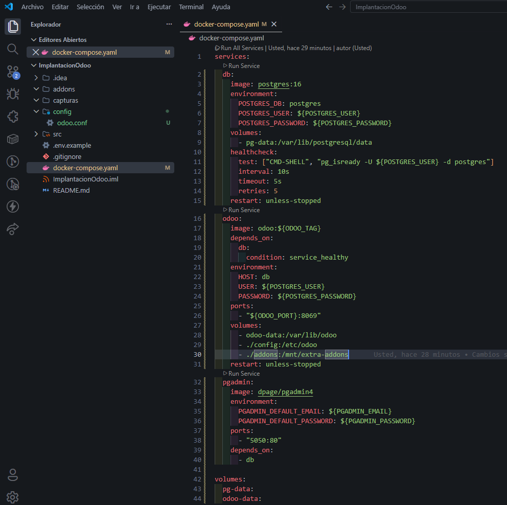

## 4. Despliegue con Docker Compose

### 4.1. Variables de entorno

Se utiliza un archivo `.env` para definir las variables de configuración de los servicios: versión y puerto de Odoo, credenciales de PostgreSQL y credenciales de pgAdmin.

Por seguridad, el archivo `.env` real no se incluye en el repositorio. En su lugar se entrega `.env.example` sin contraseñas reales.

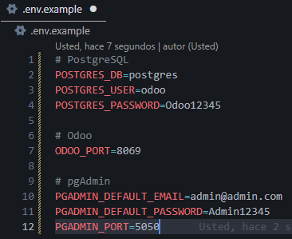

### 4.2. Configuración de Docker Compose

El archivo `docker-compose.yml` define tres servicios:

- **db:** servidor PostgreSQL 16.
- **odoo:** aplicación Odoo 19, que espera a que PostgreSQL esté preparado.
- **pgadmin:** interfaz web para administrar PostgreSQL.

También se definen volúmenes para conservar los datos de PostgreSQL y Odoo.

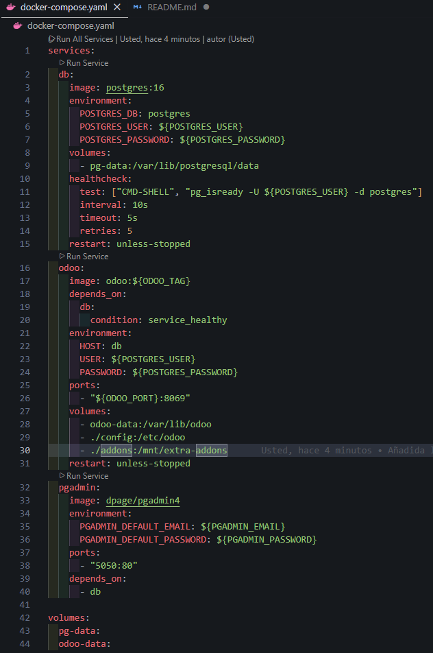

### 4.3. Configuración de Odoo

El archivo `config/odoo.conf` contiene las opciones de configuración de Odoo, como la ruta de módulos adicionales, la contraseña maestra y el directorio de datos.

La contraseña maestra real no debe publicarse en GitHub. En la versión entregada se debe utilizar un valor de ejemplo o una indicación para que cada persona configure el suyo.

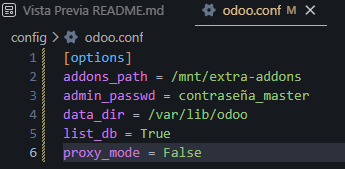

### 4.4. Arranque y comprobación de los servicios

Para iniciar los servicios se utiliza:

```bash
docker compose up -d
```

Para comprobar su estado:

```bash
docker compose ps
```

Para consultar los registros de Odoo:

```bash
docker compose logs -f odoo
```

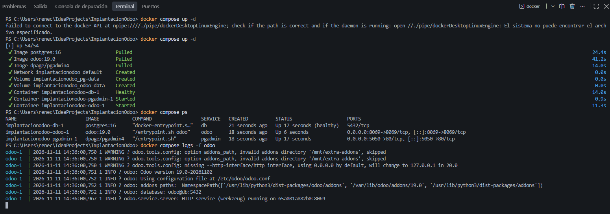

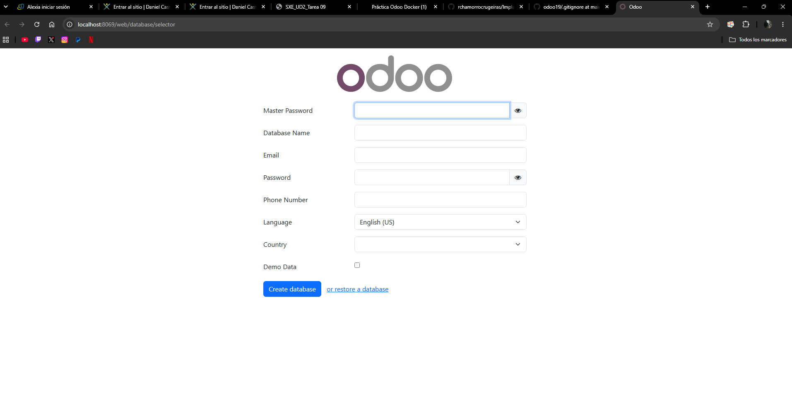

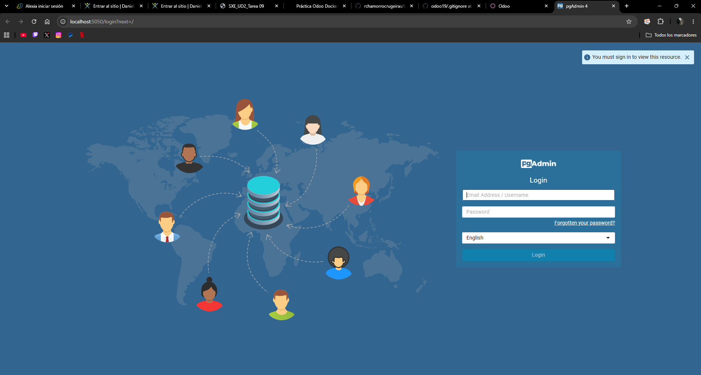

## 5. Bases de datos

Se crearán dos bases de datos independientes:

| Base de datos | Datos de demostración | Finalidad |
|---|---|---|
| `demo` | Sí | Explorar Odoo con datos de ejemplo |
| `real` | No | Preparar la empresa desde cero para la actividad 2 |

Las dos bases de datos se crearán en español y con España como país.


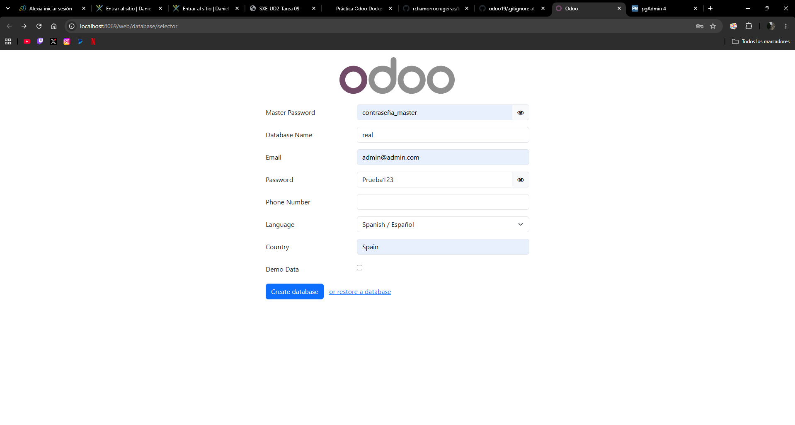

## 6. Aplicaciones y tipos de producto

En la base de datos `demo` se comprobará que están instaladas las aplicaciones Contactos, Ventas, Facturación e Inventario.

### 6.1. Aplicaciones instaladas

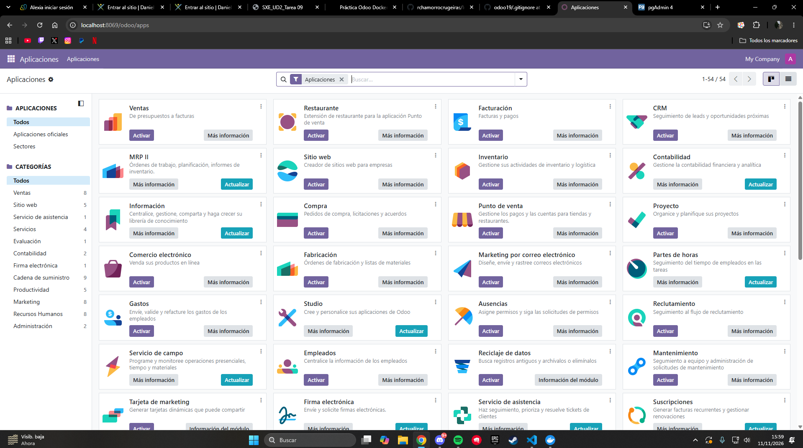

### 6.2. Tipos de producto e impuestos

Se revisarán productos de demostración para identificar los tipos disponibles en Odoo 19:

- **Bienes con rastreo de inventario:** productos físicos cuyo stock se controla.
- **Bienes sin rastreo de inventario:** productos físicos cuyo stock no se controla.
- **Servicio:** prestaciones que no se entregan físicamente.
- **Combinación:** conjunto de productos que se vende conjuntamente.

En cada ficha se comprobarán el precio de venta, el coste, la categoría, la unidad de medida y los impuestos de ventas y compras, cuando estén asignados.

| Tipo | Producto revisado | Rastreo | Impuesto de ventas |
|---|---|---|---|
| Bienes con rastreo | Armario con puertas | Si | Ninguno |
| Bienes sin rastreo | Mesa de comedor para exteriores | No | Ninguno |
| Servicio | Alojamiento de hotel | Ninguno | Ninguno |
| Combinación | Set para oficina | Ninguno | Ninguno |

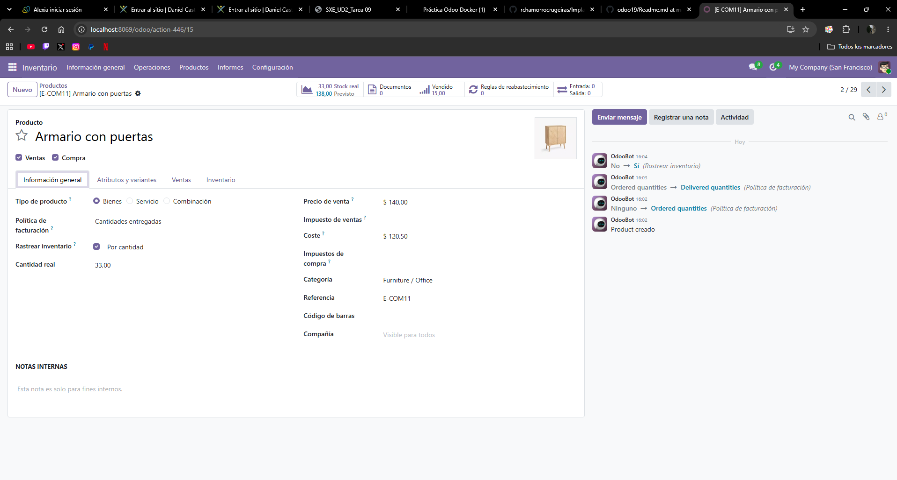
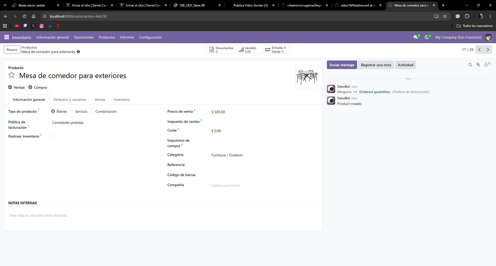
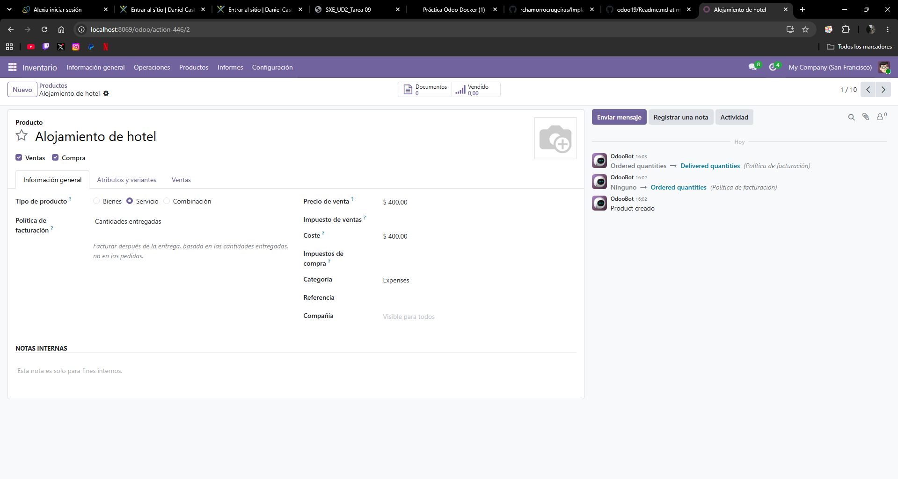
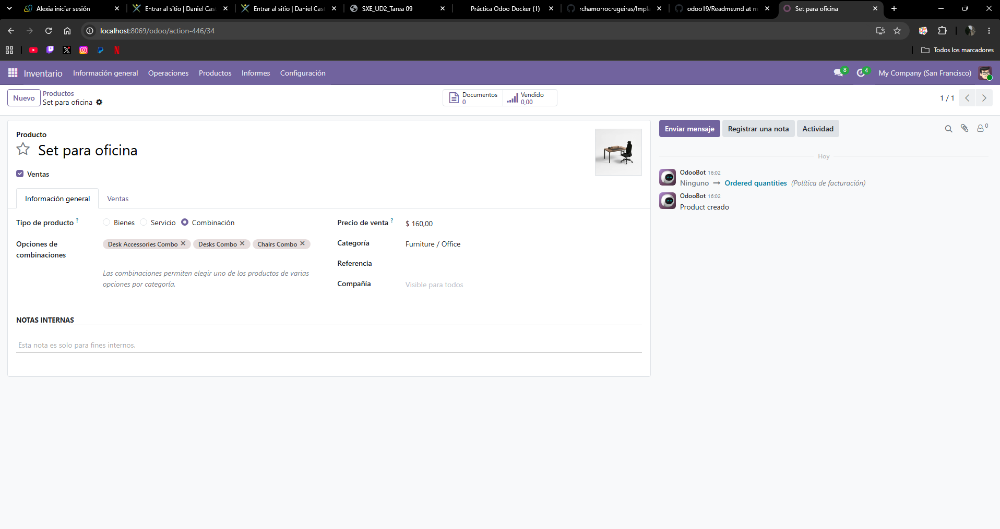

## 7. Recorrido: del cliente a la factura pagada

### 7.1. Contactos: empresa y persona

Se abrirá un contacto de tipo empresa y otro de tipo persona para observar la diferencia entre **Compañía** e **Individuo**, y comprobar cómo una persona puede quedar vinculada a una empresa.

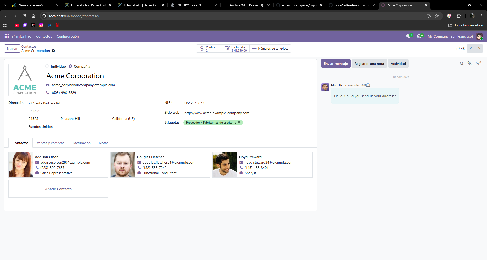
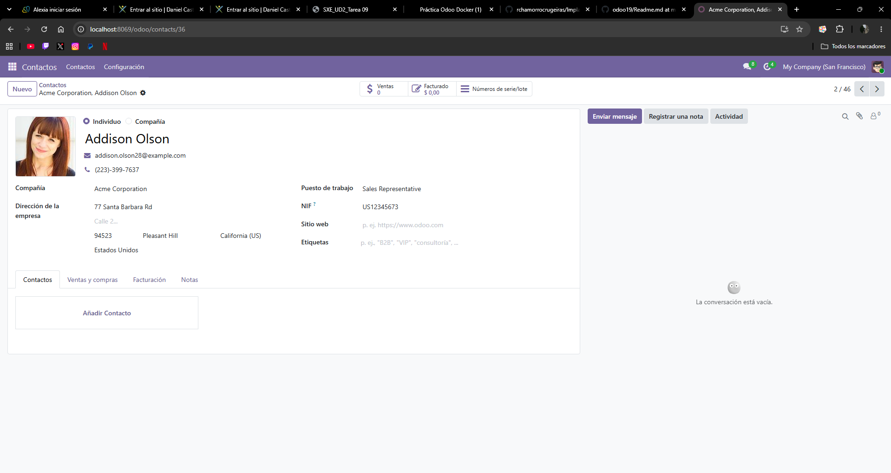

### 7.2. Crear un cliente

Se creará un cliente nuevo indicando su CIF, dirección y una etiqueta.

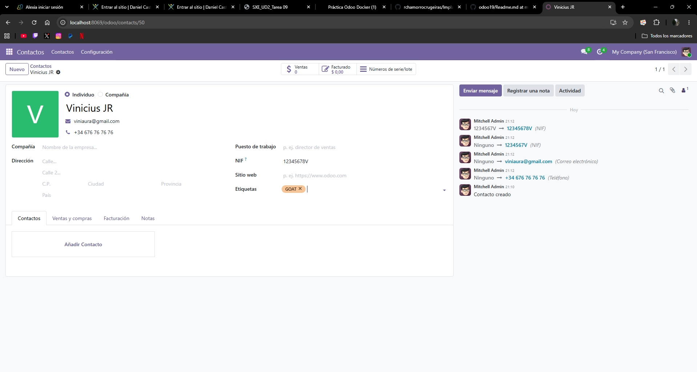

### 7.3. Crear los productos del ejercicio

Se crearán estos dos productos:

| Producto | Tipo | Precio de venta | Impuesto de ventas | Se puede vender |
|---|---|---:|---:|---|
| Hora de soporte | Servicio | 40 € | 21 % | Sí |
| Libro técnico | Bienes | 25 € | 4 % | Sí |

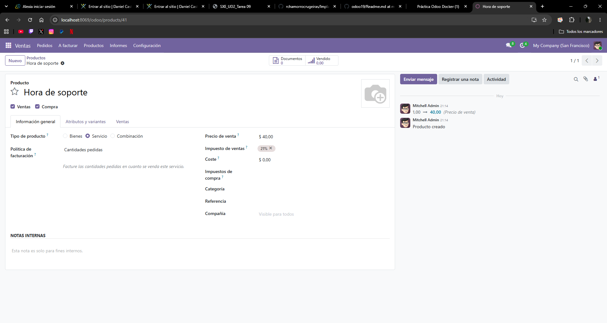
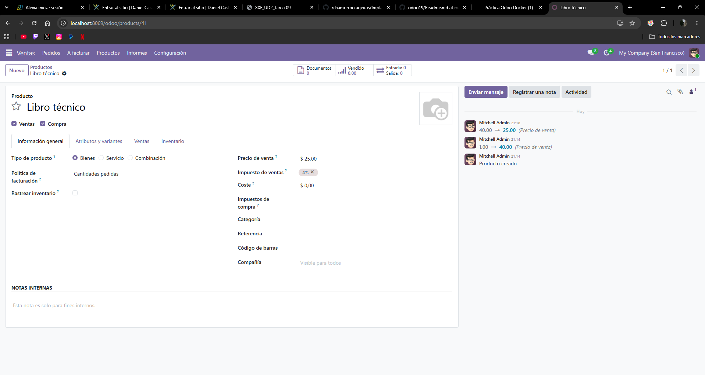

### 7.4. Crear y confirmar el presupuesto

Se creará un presupuesto para el cliente anterior, incluyendo los dos productos. Se enviará sin realizar un envío de correo real y se confirmará para convertirlo en pedido de venta.

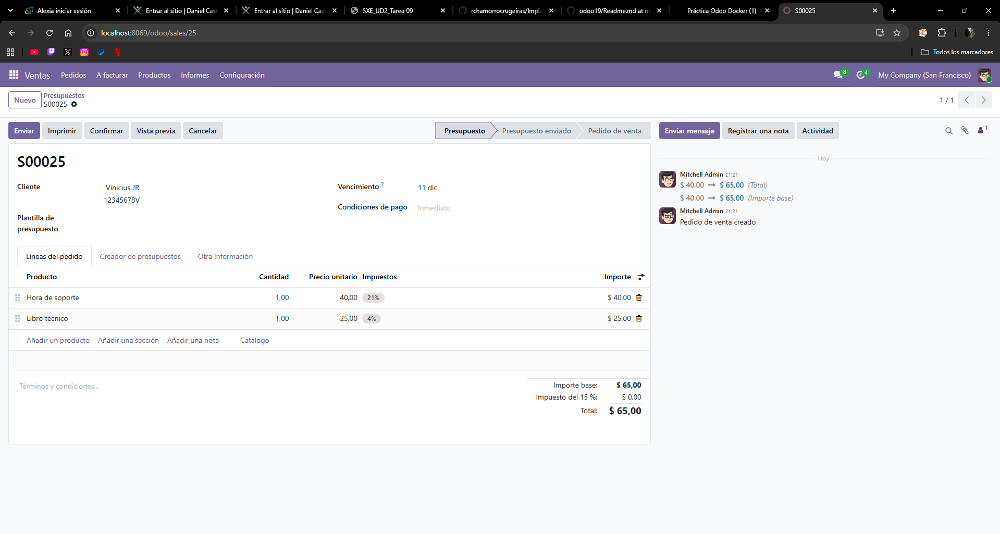
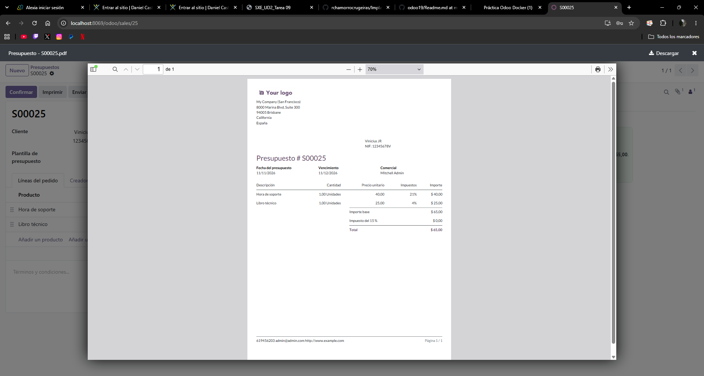

### 7.5. Crear, confirmar y pagar la factura

Desde el pedido de venta se creará la factura. Se comprobará que cada línea tiene su impuesto correspondiente y que los importes son correctos. Después se confirmará la factura, se imprimirá en PDF y se registrará el pago.

## 8. Vistas, búsquedas y filtros

En Odoo se comprobarán las siguientes opciones:

- **Vista kanban:** muestra los registros como tarjetas.
- **Vista lista:** muestra varios registros en filas y columnas.
- **Vista formulario:** permite consultar y editar un registro.
- **Filtros:** permiten mostrar los registros que cumplen determinadas condiciones.
- **Agrupar por:** organiza los registros según un campo.
- **Favoritos:** permite guardar una búsqueda para reutilizarla.

### 8.1. Búsqueda guardada de facturas publicadas

En Facturación → Clientes → Facturas se mostrarán únicamente las facturas publicadas, agrupadas por cliente y en vista lista. La búsqueda se guardará como favorito.

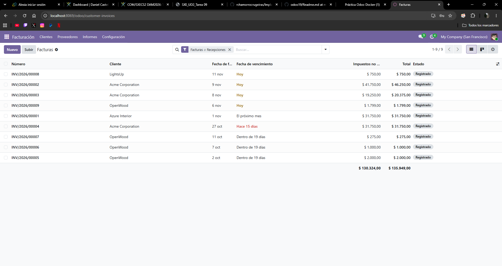

## 9. Modo desarrollador

Se activará el modo desarrollador mediante las dos vías indicadas en el enunciado:

1. Desde Ajustes, en Herramientas de desarrollador.
2. Añadiendo `?debug=1` a la dirección de Odoo.

Cuando esté activo, aparecerá el icono del escarabajo en la barra superior.

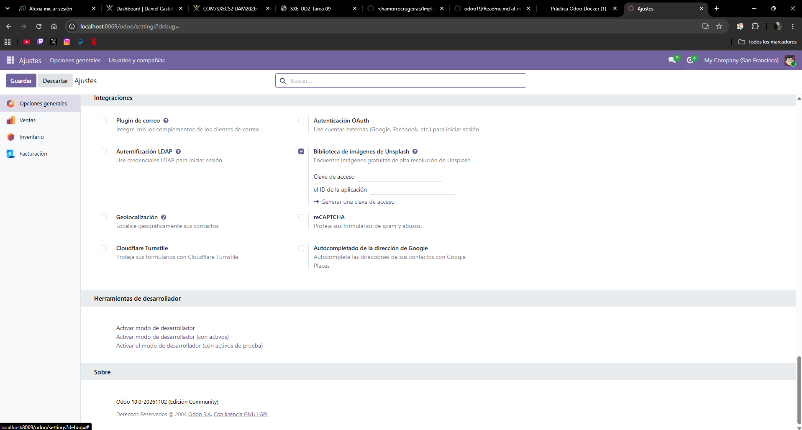
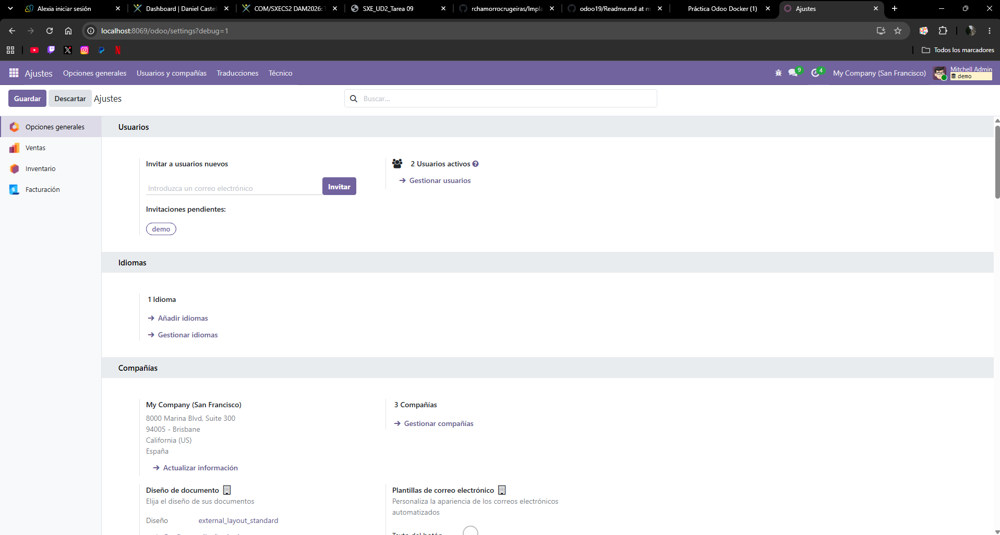

Con el modo desarrollador activado se identificarán dos campos técnicos del formulario de contacto y el modelo de una factura.

## 10. Incidencias encontradas y soluciones

| Fecha | Síntoma / mensaje de error | Causa | Solución aplicada |
|---|---|---|---|
| [11/11/2026] | Al ejecutar docker --version en la terminal de VS Code aparecía que el comando no se reconocía. | Docker no estaba añadido correctamente a la variable de entorno PATH o VS Code no había actualizado la configuración. | Se comprobó la instalación de Docker Desktop, se actualizó el PATH y se reinició la terminal de VS Code. |


## 11. Declaración de uso de IA

Se ha utilizado ChatGPT para la creación de la estructura del README según las bases que se implantan en la práctica, en ningún momento se ha utilizado para generar código o ayudar en las pautas de la práctica

## 12. Conclusión

Con esta práctica he aprendido a instalar y configurar Odoo 19 mediante Docker Compose, utilizando PostgreSQL y pgAdmin. También he conocido el funcionamiento de Odoo, la creación de bases de datos, la gestión de contactos, productos, presupuestos y facturas.

---

## Anexo · Organización de las capturas


```text
sxe_tarea09/
├── README.md
├── .gitignore
├── docker-compose.yml
├── .env.example
├── config/
│   └── odoo.conf
├── addons/
└── capturas/
    ├── 01-estructura-proyecto.png
    ├── 02-env-example.png
    ├── 03-docker-compose.png
    └── ...
```